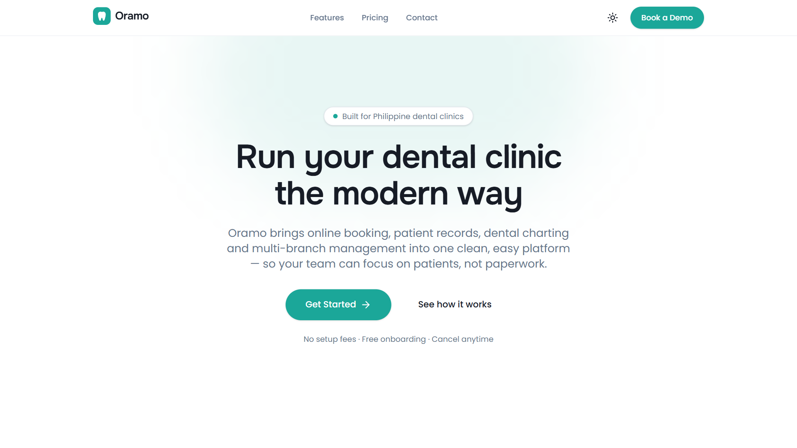
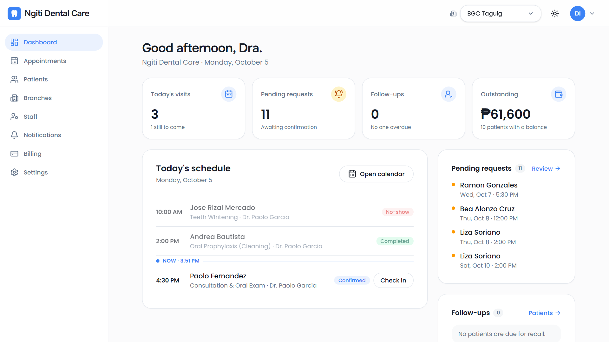
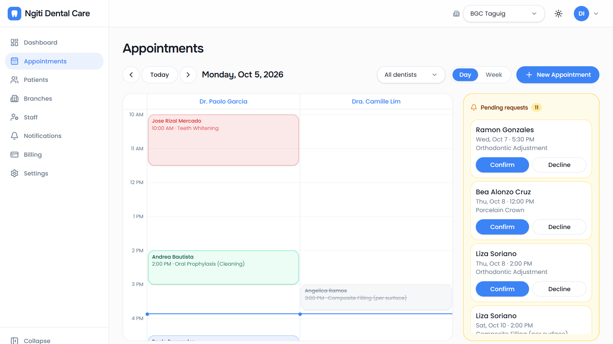
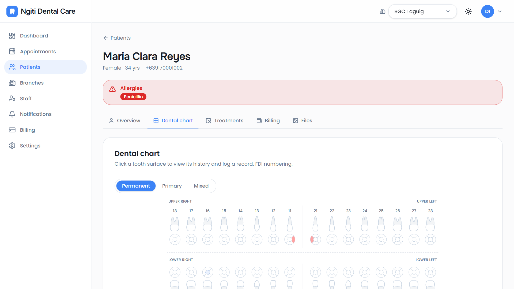
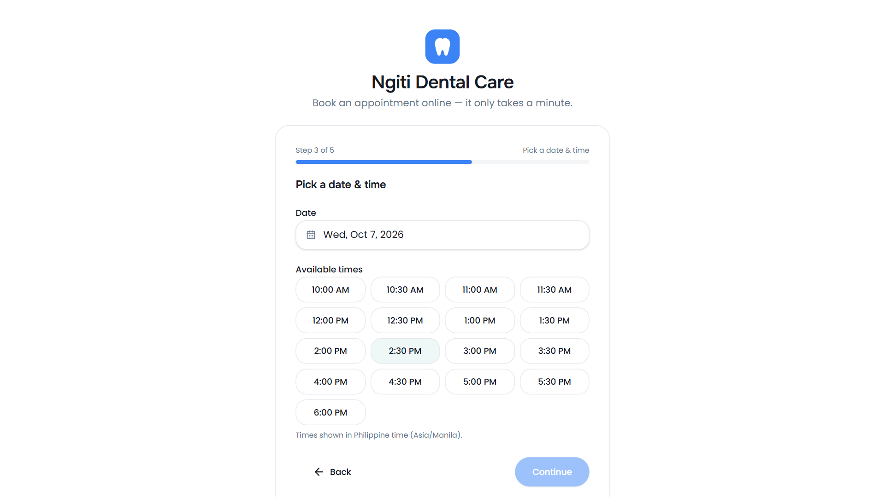
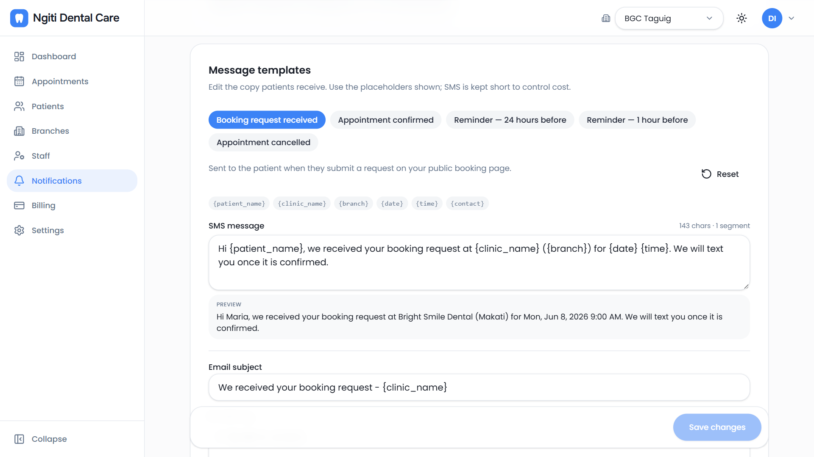
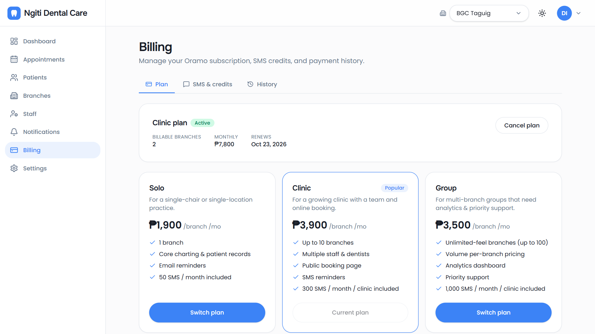

<div align="center">


# Oramo

**Clinic management software for Philippine dental practices: appointments, dental charting, patient records, SMS reminders and online booking, all in one multi-tenant SaaS.**

</div>

Clinics sign up, set up their branches and services, and share a branded booking link with patients. Staff run the day from a calendar with one column per dentist. Dentists chart on an FDI odontogram, and patients get SMS and email reminders automatically. Each clinic is isolated from every other clinic **at the database level**, and every clinic can white-label the app with its own logo and color.

> **Note on this repository.** This is the public showcase for Oramo. It holds documentation, architecture notes and screenshots. The application source is in a private repository. If you're a hiring manager or engineer who'd like a walkthrough or access, [reach out](#contact).

🔗 **Live demo:** [oramo-jocobadique.vercel.app](https://oramo-jocobadique.vercel.app). It runs as a demo clinic, "Ngiti Dental Care", with seeded, fictional data.

| | |
| --- | --- |
| Staff dashboard | [Log in](https://oramo-jocobadique.vercel.app/login) with `demo@oramo.app` / `OramoDemo2026!` |
| Patient booking page | [oramo-jocobadique.vercel.app/ngiti-dental](https://oramo-jocobadique.vercel.app/ngiti-dental) |

The demo login is shared, so please don't enter real patient information.

---

## Screenshots



| Today dashboard | Appointments calendar |
| --- | --- |
|  |  |
| **Patient record + odontogram** | **Public booking page** |
|  |  |
| **SMS notifications** | **Plan & billing** |
|  |  |

---

## What it does

- **Multi-branch clinics.** A clinic (the tenant) has branches, services, dentists and staff. A branch switcher scopes the whole dashboard. Owners, dentists and staff each see a role-gated app.
- **Appointments calendar.** Day and week views with a column per dentist, bounded by each branch's operating hours. Status moves through `requested → confirmed → checked-in → completed` with one-click transitions and optimistic updates. A soft double-booking warning flags overlaps.
- **Public booking page.** Every clinic gets `oramo.app/<slug>`, branded with its logo and color. Patients book without an account, and requests land in the clinic's **Pending requests** queue for staff to confirm.
- **Dental charting.** An interactive **FDI odontogram** with permanent, primary and mixed dentition and 5-surface teeth. It uses a controlled clinical vocabulary and one-tap treatment templates. History is **append-only**, and the current chart is derived from it.
- **Full patient records.** A **PDA-style medical-history questionnaire** stored as structured data, an allergy and medical-alert banner, a treatment timeline, per-patient billing with a printable receipt, and X-ray and photo uploads.
- **SMS + email notifications.** Request-received, confirmed and cancelled messages, plus 24-hour and 1-hour reminders, sent through a PH SMS gateway. Clinics edit their own templates with a live SMS segment count.
- **SaaS billing.** Per-branch pricing in pesos, a 14-day trial with no card, and metered SMS credits. It integrates **PayMongo** (GCash, Maya and card) through webhooks.
- **White-label theming.** Each clinic's primary color and logo re-brand the dashboard and booking page at runtime, in light and dark mode.

---

## Tech stack

| Layer | Choice |
| --- | --- |
| Framework | **Next.js 16** (App Router, Server Components, `proxy.ts`) |
| Language | **TypeScript** (strict) |
| UI | **React 19** + **Tailwind CSS v4** + shadcn/ui (Radix) |
| Data & auth | **Supabase**: Postgres, Row-Level Security, Auth, Storage |
| Background work | **Supabase Edge Functions** + `pg_net` + `pg_cron` |
| Server state | **TanStack Query v5** (optimistic updates with rollback) |
| Client state | **Zustand** (ephemeral UI only) |
| Payments | **PayMongo** (hosted Checkout + signed webhooks) |
| Messaging | **Semaphore** (PH SMS) + **Resend** (email), behind swappable provider interfaces |
| Rate limiting | **Upstash Redis** REST, with an in-memory fallback |
| Deploy | **Vercel** (Singapore) |

Architected and built solo, **AI-assisted with [Claude Code](https://claude.com/claude-code)** to move fast without cutting corners on architecture or security.

---

## How it's built

A quick tour of the engineering decisions. For the full breakdown, see **[docs/ARCHITECTURE.md](docs/ARCHITECTURE.md)**.

- **Tenant isolation lives in the database, not the app.** Every tenant table carries `clinic_id` and an RLS policy of the form `clinic_id = auth_clinic_id()`. App code never filters by clinic. A SQL test suite impersonates Clinic A and asserts it can't read or write Clinic B.
- **The public surface is two functions wide.** Anonymous booking can't touch any table directly. It goes through two `SECURITY DEFINER` RPCs that return only public-safe fields and force `status = 'requested'`. The route in front of them adds a honeypot, a CAPTCHA hook, server-side validation and per-IP plus per-mobile rate limits.
- **Privilege changes go only through audited RPCs.** Column-level grants stop users from setting their own `role` or `clinic_id`. Promotions happen only inside owner-checked definer functions.
- **Notifications are fired by the database.** A trigger on `appointments` and a 15-minute `pg_cron` sweep both call one Edge Function. A unique index plus claim-then-send makes every message **exactly-once**, even when sweeps overlap.
- **Billing state comes from webhooks.** PayMongo webhooks are HMAC-verified on the raw body and deduplicated by event ID. Entitlements are never granted from the client redirect. One pure function, `computeEntitlements()`, gates both the UI and the server.
- **Derived values come from the database.** Clinical charge balances and statuses are computed by triggers. The current dental chart is a pure function over append-only history.
- **Built for PH from day one.** Times are stored in UTC and shown in Asia/Manila. The app uses PH mobile validation, FDI notation (the standard in PH dental schools), PDA medical-history fields and peso pricing.

---

## Architecture at a glance

```
             ┌──────────────── Clinic (tenant, RLS by clinic_id) ────────────────┐
 Patient ──► │ /<slug> booking ──► requested ──► Pending queue ──► confirmed ... │
 (no login)  │        │                                                          │
             │        └─ DB trigger ─► Edge Function ─► SMS / email (exactly once)│
 Staff ────► │ Calendar · Patients · Odontogram · Billing · Notifications        │
             └───────────────────────────────────────────────────────────────────┘
 PayMongo ──► signed webhook ──► subscription state ──► entitlements (UI + server)
```

See **[docs/ARCHITECTURE.md](docs/ARCHITECTURE.md)** for the data model, the RLS contract, the booking security model, the notification pipeline and the billing state machine.

---

## Contact

Built by **Joco Badique**, Software Engineer.

- 📧 badiquejoco@gmail.com
- 💼 https://www.linkedin.com/in/joco-badique-494b341b0/
- 🔒 Source code available on request.

---

<sub>Oramo · built with Next.js, React, TypeScript & Supabase · AI-assisted with Claude Code</sub>
